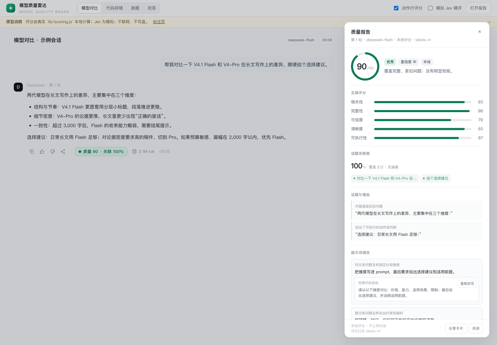
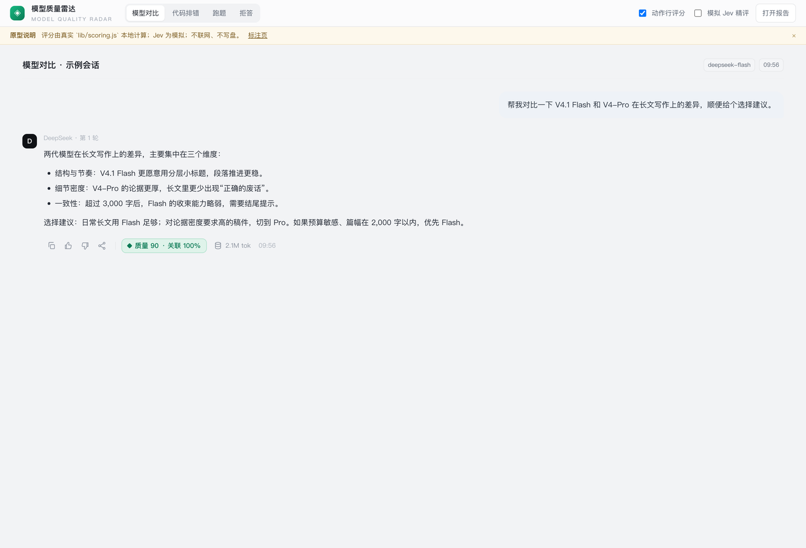
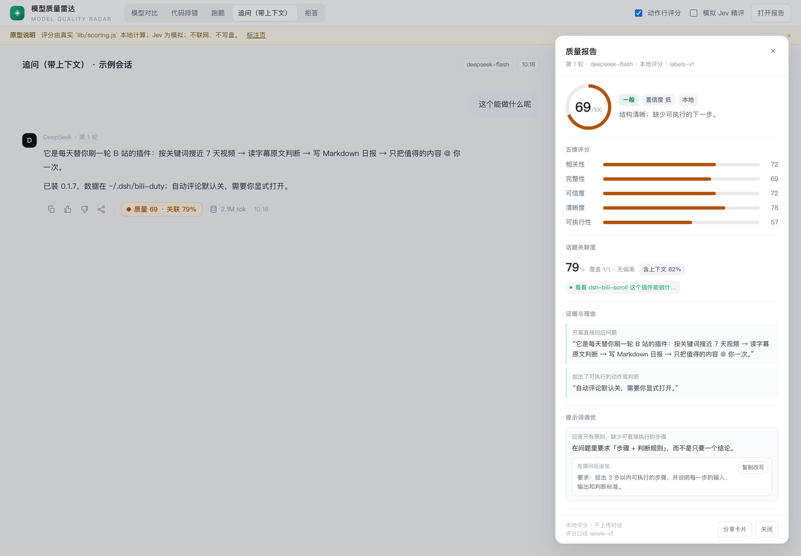

# 模型质量雷达 · Model Quality Radar

[](LICENSE)
[](https://github.com/deepseek-ai/DeepSeek-Harness)
[](https://github.com/lishinho/dsh-quality-lens/actions/workflows/test.yml)

> 给每个 AI 回答做一次体检：动作行显示 **质量分 + 话题关联度**，点开是带证据的质检报告。
> 更重要的是——它把「回答哪里弱」翻译成 **下次怎么问**，每条建议都能一键复制成更好的 prompt。
> **只观测，不改写**：不 steer、不重写、不打断流式输出。



---

## 三个实际好处

### 1. 帮你优化提示词，而不只是给答案打分

报告底部的「提示词调优」会根据回答的短板反推提问方式：

- 子问题没答全 → 建议把问题拆成编号，要求逐条回答；
- 建议不可执行 → 要求「步骤 + 判断规则」；
- 出现绝对化断言 → 要求来源、不确定性与适用前提；
- 对比题没维度 → 直接把「价格 / 能力 / 场景 / 限制」写进 prompt。

每条建议都带一段**可直接复制的改写提问**（保留原问题，只追加要求），点「复制改写」就能拿去下一轮。

### 2. 观测每条回答的质量与关联度

- 动作行内嵌 `◆ 质量 90 · 关联 100%`，无分不渲染、不占位、不抖动；
- 五维评分：相关性 / 完整性 / 可信度 / 清晰度 / 可执行性；
- 话题关联度：问题拆成子意图，标出覆盖、部分覆盖与偏离段落；
- 证据引用：每条结论都能回到回答原文，不是凭空打分；
- **上下文感知**：追问（「这个呢」「为什么」）会参考上一轮问题与上一轮回答，不会被关键词误判为跑题；
- 置信度与评分口径公开，分数只用于比较表达与任务达成，**不做事实裁决**。

### 3. 分析可解释、可校准，Jev 精评可选

- 默认是**本地标签引擎**：把回答分类成显式标签（意图 / 结构 / 证据 / 绝对化 / 跑题 / 覆盖…），再由标签映射到分数；确定性、离线、零成本。
- 需要更强语义判断时，可开启 **Jev**（TypeSafe 的非生成式决策模型）：一次请求用类型化的 `score` / `noul` 问题拿回带置信度的判定，失败自动回退本地分，不阻塞 UI。
- 附带**校准工具**：从本机历史会话抽 20 条问答、人工打分、跑 MAE / Spearman，按真实偏差调规则，而不是拍脑袋。
- 上下文关联、同义词归一、长词加权、承接分，都是为了让「关联」评的是**是否推进当前任务**，而不是关键词重不重合。

---

## 为什么是「观测」，不是「自动改写」

| | 自动评审 + 重写类插件 | 模型质量雷达 |
|---|---|---|
| 对答案的影响 | 低于阈值就让模型重写，改变你看到的输出 | **不改写**，只在回答落盘后分析 |
| 成本 | 每轮至少一次评审模型调用 | 默认本地 0 token；Jev 按需 |
| 额外收益 | 只告诉你分数 | 分数 + 证据 + **可复制的提示词改进** |
| 适用场景 | 追求"自动改到好" | 追求"看清问题、下次问得更好" |

---

## 界面预览

> 以下为交互原型截图（和插件共用同一套评分引擎与布局），实际安装后动作行 Chip 与报告面板一致。

| 动作行 Chip | 追问场景：含上下文 |
|---|---|
|  |  |

**报告面板**：五维、话题关联、证据、提示词调优（可复制改写）：


> 分享卡为规划中的设计，当前插件版本以动作行 + 报告为主。

只想先点一点看效果？打开自包含原型 [`prototype/index.html`](prototype/index.html)（双击即可，离线、不联网）。

---

## 安装

**桌面端（本地目录）**

1. 插件页 → **添加插件** → **安装第三方插件**；
2. 来源选 **本地目录**，选择本仓库根目录（包含 `package.json`）；
3. 重启 / 刷新 DSH。

**GitHub / npm（发布后）**

```sh
dsh plugin --profile web add github:lishinho/dsh-quality-lens
dsh plugin --profile web add dsh-quality-lens
```

**预构建 tarball（无需构建）**

```sh
dsh plugin --profile web add https://github.com/lishinho/dsh-quality-lens/releases/latest/download/dsh-quality-lens.tgz
```

本地打包：`pnpm pack` → `dsh plugin add ./dsh-quality-lens-0.1.0.tgz`

安装后发一条 **≥80 字**的回答，动作行会出现 Chip；确认 / 寒暄类消息（「可以了 我试试」）不会评分。

---

## 评分口径

总分 = **25% 相关性 + 20% 完整性 + 20% 可信度 + 15% 清晰度 + 20% 可执行性**。

- 「可信度」评的是**可验证的表达**（来源、不确定性、绝对化断言），不是事实核查；
- 话题关联度独立展示：`覆盖 3/3 · 无偏离`，追问时显示 `含上下文 xx%`；
- 证明不了就标低置信度；不做「模型排行榜」。

规则、标签、阈值都在 [`lib/scoring.js`](lib/scoring.js)，可读可改；`lib/client.js` 只负责渲染。

---

## 可选：Jev 精评

```yaml
- id: quality-lens
  config:
    engine: jev               # labels（默认）| heuristic | jev
    jev:
      provider: openrouter    # typesafe | openrouter | custom
      apiKeyEnv: OPENROUTER_API_KEY
      timeoutMs: 4000
```

- 一次请求：5 个维度 `score` + 绝对化/拒答/跑题 `noul` + 每个子意图一个覆盖 `noul`；
- 失败 / 超时 / 无 key：自动回退本地标签分，Chip 先在本地分上显示，精评回来再升级；
- **隐私**：Jev 是唯一会联网的路径，只发送当前问题 + 回答；默认关闭。

技术细节见 [标签评分与 Jev 方案](https://github.com/lishinho/dsh-quality-lens/blob/main/docs/label-scoring-and-jev.md)。

---

## 校准（让分数对齐你的判断）

```sh
node scripts/extract-samples.mjs --limit 20   # 从本机会话抽问答（只读本地）
node scripts/make-labeling-page.mjs           # 生成离线标注页
open calibration/labeling.html                # 1-5 星打分，导出 labels.jsonl
node scripts/apply-labels.mjs --labels calibration/labels.jsonl
node scripts/calibrate.mjs --in calibration/samples.labeled.jsonl
```

输出 MAE / RMSE / Spearman / 档位一致率 / 偏差最大的样本。目标 **MAE ≤ 8**。
校准集默认在 `calibration/`，已 gitignore，不会上传。

---

## 隐私

- 默认引擎在本地完成，**不调用模型、不联网**；
- 报告只存本机 `$DSH_HOME/quality-lens/reports.jsonl`，删目录即清空；
- 无遥测；Jev 模式需显式配置 key，且仅发送当前问答；
- 校准只读你自己的本机会话，不上传。

---

## 路线图与限制

- 已有：本地标签评分、上下文关联、提示词调优、证据、置信度、Jev 适配、校准脚本、交互原型；
- 规划中：分享卡导出、历史/趋势、Jev 影子模式（只记录不展示）、可选的匿名使用统计（默认关）；
- 当前不做：自动改写答案、公开模型排行榜、事实核查裁决。

---

## 开发

```sh
node --test test/scoring.test.mjs test/host.test.mjs test/client-bundle.test.mjs test/labels-jev.test.mjs   # 31 tests
node scripts/demo.mjs           # 打印样本评分
node prototype/build.mjs        # 重建自包含原型
```

- `lib/scoring.js` — 规则 + 标签引擎 + 提示词调优（纯函数）
- `lib/jev.js` — Jev 请求构造 / 校验 / 降级
- `lib/host.js` — 会话事件、上下文、存储、路由
- `lib/client.js` — 手写 lazy-CJS 浏览器 bundle（无构建步骤）
- `docs/` — 技术方案与上架文案

## 支持与关注（自愿）

如果它帮到了你，可以请我喝杯咖啡，或关注公众号领取《模型质量周报》。不打赏、不关注也能完整使用。

| 微信赞赏 | 支付宝 | 公众号 |
|---|---|---|
|  |  |  |

公众号：**lishinho技术杂货铺**（回复「质量」领取周报与评分模板）。

## License

MIT
